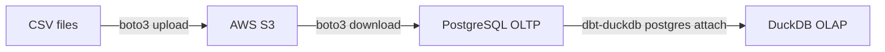

# FitConnect -- S3 + PostgreSQL + dbt-DuckDB OLAP Pipeline

An OLAP analytics pipeline for the FitConnect fitness application. CSV data is uploaded to S3, loaded into PostgreSQL, then transformed through dbt staging and mart layers into DuckDB analytics tables.

## Prerequisites

- Docker and Docker Compose
- An AWS account with an S3 bucket and access credentials

## Quick Start

```bash
cp .env.example .env
# Fill in AWS credentials and PG password in .env
docker compose up
```

The pipeline runs automatically: uploads CSVs to S3, loads them into PostgreSQL, builds all dbt models, runs tests, and generates documentation.

Once complete, dbt docs are available at **http://localhost:8080**.

## Data Flow



**Source tables** loaded into PostgreSQL: `users`, `profiles`, `exercises`, `workouts`, `workout_exercises`.
The dataset contains ~4,450 rows across 5 tables: 200 users, 200 profiles, 50 exercises, 1,000 workouts, and 3,000 workout exercises.

PostgreSQL serves as the OLTP source (raw data), DuckDB as the OLAP analytics engine. dbt reads PostgreSQL via the `postgres_scanner` extension and writes transformed models into DuckDB.

## Configuration

All settings are in `.env.example`. Copy it and fill in the required values (AWS credentials, PostgreSQL password).

## Analytics Queries

Runs 4 analytics queries against the OLAP layer: average workouts per user, workout distribution, top users by calories burned, and workout frequency by fitness goal.

```bash
docker compose --profile analytics run --rm analytics
```

## Pre-built Image

A pre-built image is available on Docker Hub:

```bash
docker pull sambot961/fitconnect-dbt:latest
```

## dbt Models

| Layer   | Model                  | Materialization | Description                                     |
|---------|------------------------|-----------------|-------------------------------------------------|
| Staging | `stg_profiles`         | view            | User profiles with standardized column names    |
| Staging | `stg_workouts`         | view            | Completed workouts only, standardized columns   |
| Test    | `test`                 | view            | Sample query for connection validation          |
| Mart    | `fitconnect_1`         | table           | Monolithic fact table built with CTEs           |
| Mart    | `user_workout_summary` | table           | Modular fact table using dbt `ref()`            |

29 dbt tests cover uniqueness, not-null, and relationship constraints across all models.

## Teardown

```bash
docker compose down -v
```
