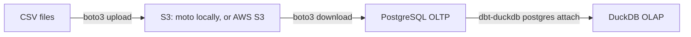

# FitConnect -- S3 + PostgreSQL + dbt-DuckDB OLAP Pipeline

[](https://github.com/tryph0n/fitconnect-dbt-duckdb/actions/workflows/ci.yml)

Learning project from a data engineering training course.

A sibling project, [fitconnect-oltp-olap-k8s](https://github.com/tryph0n/fitconnect-oltp-olap-k8s), uses the same fictional data with another stack: dlt loads it into ClickHouse on Kubernetes.

An OLAP analytics pipeline for the FitConnect fitness application. CSV data is uploaded to S3, loaded into PostgreSQL, then transformed through dbt staging and mart layers into DuckDB analytics tables.

## Prerequisites

- Docker and Docker Compose

No AWS account is necessary: Compose runs a local S3 server (moto).

## Quick Start

```bash
cp .env.example .env
docker compose up
```

The default values in `.env.example` work as they are. You do not need to edit `.env`.

The pipeline runs automatically: creates the S3 bucket, uploads CSVs to S3, loads them into PostgreSQL, builds all dbt models, runs tests, and generates documentation.

The local S3 server keeps its data in memory only. Each start begins with an empty S3, and the loader creates the bucket again.

Once complete, dbt docs are available at **http://localhost:8080**.

## Use real AWS S3 (optional)

To use AWS S3 instead of the local server, change these values in `.env`:

- `S3_ENDPOINT_URL`: leave it empty. An empty value selects AWS S3.
- `AWS_ACCESS_KEY_ID` and `AWS_SECRET_ACCESS_KEY`: your AWS access keys.
- `AWS_REGION`: the region of your bucket.
- `S3_BUCKET`: a bucket name of your own (bucket names are global on AWS). The loader creates the bucket if it does not exist.

AWS can charge for S3 storage and requests.

## Data Flow



**Source tables** loaded into PostgreSQL: `users`, `profiles`, `exercises`, `workouts`, `workout_exercises`.

PostgreSQL serves as the OLTP source (raw data), DuckDB as the OLAP analytics engine. dbt reads PostgreSQL via the `postgres_scanner` extension and writes transformed models into DuckDB.

## Data

The dataset contains 560 rows across 5 tables: 10 users, 10 profiles, 10 exercises, 104 workouts, and 426 workout exercises.

Fictional sample data for the FitConnect case study, supplied with a Jedha training course exercise. No licence stated by the source. Not covered by the code licence.

## Configuration

All settings are in `.env.example`. The defaults run the full pipeline locally. To use AWS S3, see [Use real AWS S3 (optional)](#use-real-aws-s3-optional).

## Analytics Queries

Runs 4 analytics queries against the OLAP layer: average workouts per user, workout distribution, top users by calories burned, and workout frequency by fitness goal.

```bash
docker compose --profile analytics run --rm analytics
```

## dbt Models

| Layer   | Model                             | Materialization | Description                                          |
|---------|-----------------------------------|-----------------|------------------------------------------------------|
| Staging | `stg_profiles`                    | view            | User profiles with standardized column names         |
| Staging | `stg_workouts`                    | view            | Completed workouts only, standardized columns        |
| Check   | `source_connection_check`         | view            | Reads a few user rows to check the source connection |
| Mart    | `user_workout_summary_monolithic` | table           | Monolithic fact table built with CTEs                |
| Mart    | `user_workout_summary`            | table           | Modular fact table using dbt `ref()`                 |

30 dbt tests: 29 generic and 1 singular (`tests/assert_marts_match.sql`). The generic tests cover uniqueness, not-null, and relationship constraints on the staging and mart models. The singular test checks that both mart models return the same rows.

## Teardown

```bash
docker compose down -v
```

Keep `-v`. Without it, the `dbt-data` volume keeps the DuckDB file and the CSV copy from the first run, so old tables and old data stay at the next start.

## License

The code is under the MIT License. See [LICENSE](LICENSE).
